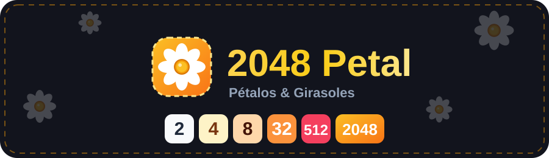

<div align="center">



<br />

<a href="https://brianperez22.github.io/2048-Petal/">
  
</a>

<br />

<a href="https://brianperez22.github.io/2048-Petal/#tutorial">
  
</a>

<br /><br />


**El clásico 2048, pero con margaritas y girasoles.** 🌼🌻
100 % front-end, sin backend y sin dependencias en tiempo de ejecución más allá de React.

</div>

---

## ✨ Características

- 🌼 Fichas florales con brillo de fusión y animaciones suaves.
- 📖 **Tutorial interactivo** de 13 pasos con mini-tableros que enseñan la estrategia de la esquina.
- ↩️ **Deshacer configurable** (0–10 movimientos) con slider.
- 🔊 Sonidos de burbuja generados con Web Audio (sin archivos de audio).
- 🏆 Récord personal e historial de partidas guardados en el navegador.
- 📱 Responsive: teclado en PC y gestos de deslizar en móvil.

## 🎮 Controles

| Acción | PC | Móvil |
| --- | --- | --- |
| Mover fichas | Flechas o `W` `A` `S` `D` | Deslizar el dedo |
| Deshacer | `U` o `Ctrl + Z` | Botón **Deshacer** |
| Sonido | `M` | Botón del altavoz |
| Tutorial | Botón `?` | Botón `?` |

## 🌐 Jugar online (GitHub Pages)

👉 **https://brianperez22.github.io/2048-Petal/**

El repo incluye el workflow `.github/workflows/deploy.yml`, que compila y publica el juego solo en cada `push` a `main`.

<details>
<summary><b>¿La página no carga? Activa Pages (solo la primera vez)</b></summary>

**Opción A – recomendada (GitHub Actions)**
1. Repo → **Settings** → **Pages**.
2. En **Build and deployment → Source** elige **GitHub Actions**.
3. Haz un push (o ve a **Actions → Deploy a GitHub Pages → Run workflow**).

**Opción B – sin Actions**
1. Repo → **Settings** → **Pages**.
2. **Source: Deploy from a branch** → rama `main` → carpeta **`/docs`** → Save.

Las dos funcionan porque `docs/index.html` ya viene compilado dentro del repo.

</details>

## 💻 Jugar en local, sin instalar nada

Abre **`docs/index.html`** con doble clic. Es un único archivo con todo incluido (JS, CSS e íconos) y funciona sin internet y desde `file://`.

## 🛠️ Desarrollo

Requiere Node.js 18 o superior.

```bash
npm install
npm run dev        # servidor local con recarga en caliente
npm run build      # revisa tipos y regenera docs/index.html
npm run typecheck  # solo revisa tipos
```

### 🚀 Publicar cambios

```bash
./actualizar.sh "mensaje del commit"
```

El script instala dependencias, compila, hace commit y sube todo a `main`. Detalles en `./actualizar.sh --ayuda`.

## 🗂️ Estructura

```
2048-Petal/
├── actualizar.sh              # compila + commit + push
├── .github/workflows/         # deploy automático a GitHub Pages
├── assets/                    # banner y botones del README
├── docs/index.html            # juego compilado (local + Pages)
└── src/
    ├── App.tsx                # Juego ⇄ Tutorial (ruteo por #hash)
    ├── game/                  # lógica pura + reducer
    ├── hooks/                 # useGame, useKeyboard, useSwipe, useHashView
    ├── lib/                   # audio, favicon, storage, estilos de ficha
    └── components/
        ├── tutorial/          # página de tutorial, slides y mini-tableros
        └── ...                # Header, Board, TileView, paneles
```

## 📜 Licencia

Proyecto personal de **Brian Pérez**. Uso educativo y demostrativo.
